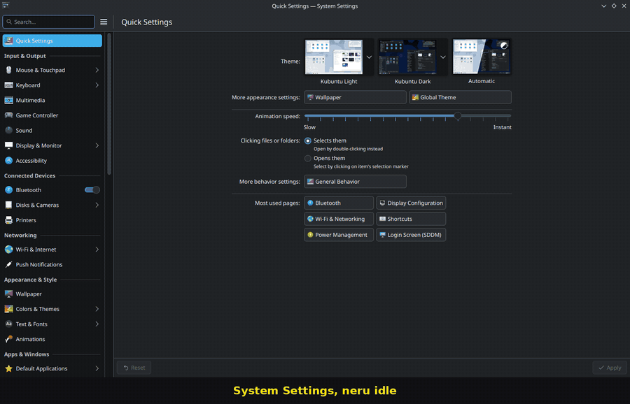

<div align="center">



**Hints, grids and vim keys for your whole KDE desktop.**
Windows, taskbar, tray popups and desktop icons, all without touching the mouse.

</div>

> Beru is a fork of [Neru](README-NERU.md) by y3owk1n, tuned for KDE Plasma 6 on
> Wayland. The name is a nod to Beru from *Solo Leveling*, and the project has no
> connection to that series. The code underneath is still Neru's (MIT), so the
> command, config folder and service are still called `neru`.

<div align="center">



<sub>Recorded in System Settings. <a href="demo/beru-kde-demo.mp4">Video version</a></sub>

</div>

## What it does

A dead touchpad shouldn't lock you out of your desktop. Beru puts a label on
everything you can click, and you type it.

- **Hints**: labels on every clickable thing in the focused window, the taskbar, the tray (and its popups) and the desktop icons.
- **Grid**: split the screen into cells and zoom in with a few keys. Works where hints can't see, like canvases and Electron apps.
- **Scroll**: `j` `k` `gg` `G`, anywhere.
- **Local**: one small background daemon, no network access, no telemetry.

## Keys

Set these up once under System Settings, Shortcuts, Custom Shortcuts:

| Keys | Command | What happens |
| --- | --- | --- |
| `Meta+F` | `neru hints --action left_click` | Labels appear, type one to click it |
| `Meta+Shift+F` | `neru hints --action right_click` | Same, but right-click |
| `Meta+Shift+G` | `neru recursive_grid --action left_click` | Zoom in 3x3 at a time, click where you land |
| `Meta+S` | `neru scroll` | Vim-style scrolling at the cursor |
| `Meta+Escape` | `neru idle` | Leave any mode |

Inside the grid, `Shift+L`, `Shift+R` and `Shift+M` click. Add `Return` and a
double-click if you like:

```toml
[recursive_grid.hotkeys]
"Return" = "action left_click"
"Shift+D" = "action left_click,left_click"   # double-click
```

## Where it works

| Surface | Hints | Notes |
| --- | --- | --- |
| Qt and KDE apps (Dolphin, System Settings, KCalc, Konsole) | Yes | |
| Taskbar, tray and tray popups | Yes | The Bluetooth popup works, so you can connect devices by keyboard |
| Desktop icons | Yes | Show the desktop first (`Meta+D`) |
| Electron apps (Claude Desktop, VS Code, Teams) | Barely | They expose almost nothing, use the grid |
| Browsers | Skipped | Keep Vimium-C, or list them under `general.excluded_apps` |

## Tricks

- **Jump by name.** `neru hints --text Bluetooth --action left_click` only labels elements matching the text.
- **Click a chain.** Add `--repeat` to a hint or grid command to stay in the mode and click several things in a row.
- **Aim, then act.** `neru recursive_grid` with no `--action` just moves the cursor, so you can place it and use `Shift+L/R/M` yourself.
- **Make it readable.** The grid font and colors are plain config:

  ```toml
  [recursive_grid.ui]
  font_size = 22
  text_color = "#FFFFE000"
  label_background = true
  label_background_color = "#E6000000"
  ```

- **Skip an app.** `excluded_apps = ["firefox", "brave-browser"]` under `[general]` keeps Beru out of those windows.
- **Reload live.** `neru config reload` applies config edits without restarting.

## Make it scriptable

Everything is a command, so it plugs into other tools. These come from Neru and
work the same here:

- **Macros and hooks** run your own steps when a mode opens, closes or the focused app changes.
- **Per-app overrides** change roles, hotkeys or grid scope for one app.
- **`neru query`** reports displays, the cursor, the focused window and what hints would label. `neru watch` streams events.
- **A local socket** with a versioned protocol and a Go client, for anything you want to build on top.

## Setup

Keyboard capture needs your user in the `input` group and a writable
`/dev/uinput` ([Linux setup](docs/guide/linux.md)). Build it as upstream describes
in [`docs/contributing/development.md`](docs/contributing/development.md). On
Ubuntu that means the packages listed in
[`.github/workflows/ci.yml`](.github/workflows/ci.yml) and Go 1.26. For a `beru`
command, run `ln -s neru ~/.local/bin/beru`.

## Credits

Built on [Neru](https://github.com/y3owk1n/neru) by y3owk1n and its
contributors, under the MIT license. See [`LICENSE`](LICENSE).
